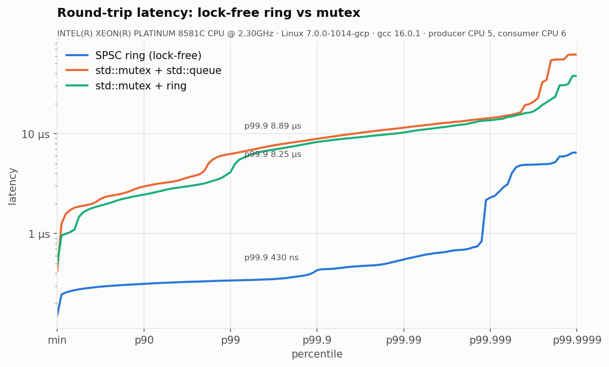

# Lock-free SPSC ring buffer + latency benchmark harness (C++26)

A wait-free single-producer / single-consumer queue in **C++26**, measured
against `std::mutex` + `std::queue` with a reusable, language-neutral benchmark
harness: Google Benchmark, TSC timestamps, pinned threads,
coordinated-omission-safe latency, HDR-style percentile plots, an ablation
study, a platform-noise probe, and flame graphs from a sampling profiler
written for Windows.

Measured on two very different machines, 5 M samples per figure, producer and
consumer pinned to separate cores:

* **Server:** Google Cloud `c4-standard-16`, Intel Xeon Platinum 8581C (Emerald
  Rapids), Linux 7.0, SMT off, **cores isolated** (`isolcpus`, `nohz_full`,
  `rcu_nocbs`), GCC 16.
* **Desktop:** Intel Core i5-6500T (Skylake, 4 cores), Windows 11 with
  VBS/Hyper-V, GCC 16.2.

| Round trip (P → C → P) | p50 | p99 | p99.9 | p99.99 |
|---|---:|---:|---:|---:|
| **ring, server (Linux, isolated)** | **281 ns** | **339 ns** | **430 ns** | **550 ns** |
| `std::mutex` + `std::queue`, server | 1.90 µs | 6.26 µs | 8.89 µs | 11.5 µs |
| **ring, desktop (Windows)** | **156 ns** | **178 ns** | **527 ns** | 17.3 µs |
| `std::mutex` + `std::queue`, desktop | 4.01 µs | 40.9 µs | 75.3 µs | 169 µs |

| One-way, 1 msg/µs offered load | p50 | p99 | p99.9 |
|---|---:|---:|---:|
| **ring, server (Linux, isolated)** | **158 ns** | **196 ns** | **233 ns** |
| `std::mutex` + `std::queue`, server | 926 ns | 5.51 µs | 7.50 µs |
| ring, desktop (Windows) | 89 ns | 14.0 µs ¹ | 50.4 µs ¹ |

| Saturated throughput | per message | batches of 32 |
|---|---:|---:|
| **ring, server** | **142 M msg/s** | **172.5 M msg/s** |
| `std::mutex` + `std::queue`, server | 3.6 M msg/s | 40.2 M msg/s |
| ring, desktop | 61.5 M msg/s | 186 M msg/s |

**What the two machines show together:**

* **Isolated cores remove the tail.** On the server the ring stays under 1 µs
  out to p99.99, and one-way p99 is 196 ns. On the desktop, everything past ~p95
  is Windows interrupting the pinned cores ¹.
* **The desktop has the faster median** (156 vs 281 ns). A 4-core desktop chip
  passes cache lines between cores over a short ring bus; a large server Xeon
  uses a mesh, so each core-to-core transfer costs more, plus some VM overhead.
* **The mutex gap depends on the OS.** Linux's futex-based `std::mutex` is far
  better than MinGW's on Windows, so the ring's lead at p50 is 6.8× on the server
  and 26× on the desktop. At p99.9 it is 21× and 143×.

¹ The desktop's built-in noise probe measured ~2,300-2,900 interruptions/s of
~15 µs each on the pinned cores; the server's isolated cores measured ~15/s.
See [RESULTS.md §4 and §8](docs/RESULTS.md).



## v2: what changed and what it bought

| | v1 (C++20) | **v2 (C++26)** | |
|---|---:|---:|---:|
| Round trip p50 / p99 | 238 / 299 ns | **156 / 178 ns** | -34 % / -40 % |
| Throughput | 41.2 M/s | **61.5 M/s** | +49 % |
| Batched throughput | – | **186 M/s** | 4.5× v1 |

* **Speed: the "ready" signal moved into the slot.** v1's consumer read the
  producer's `tail`, then the slot: two dependent cross-core cache misses. v2
  slots carry a sequence number in the same cache line as the payload, so a
  hand-off is one line transfer. The v1 design is still measured in every run
  (`ring_index`) and reproduces v1's numbers, so the gain is the design, not a
  quieter machine.
* **Speed: batch API.** `try_push_n` / `try_pop_n` publish once per batch.
* **C++26:** contracts (`void pop() pre(readable())`, checked in tests,
  compiled out of benchmarks), static reflection (`machine.json` and variant
  descriptions generated from the structs), `template for` over the variant
  table, `= delete("reason")`, `std::inplace_vector`, `std::saturating_cast`,
  `std::breakpoint_if_debugging`. Each one is explained in
  [DESIGN.md §7](docs/DESIGN.md).

## What's in here

| | |
|---|---|
| [`include/spsc/ring_buffer.hpp`](include/spsc/ring_buffer.hpp) | The queue. Header-only, no dependencies |
| [`docs/DESIGN.md`](docs/DESIGN.md) | Layout, correctness of slot sequencing, memory ordering, C++26 features |
| [`docs/RESULTS.md`](docs/RESULTS.md) | **The write-up**: numbers, flame graphs, why the queues differ, v1→v2, ablations, the optimisation that didn't help |
| [`docs/HARNESS_SPEC.md`](docs/HARNESS_SPEC.md) | The harness contract (clock, scenarios, statistics, file format) for the Rust port |
| [`bench/`](bench/) | Google Benchmark driver and profiling driver |
| [`harness/`](harness/) | Pinning, TSC clock, latency recorder, reflection helpers, Windows sampling profiler |
| [`tools/`](tools/) | `analyze.py` (plots + summary, multi-implementation overlay), `flamegraph.py` |
| [`results/i5-6500T_win11/`](results/i5-6500T_win11/) | Raw results: per-percentile CSVs, histograms, GB JSON, flame graphs, [`SUMMARY.md`](results/i5-6500T_win11/SUMMARY.md) |

## The queue in one paragraph

Monotonic 64-bit indices with a power-of-two mask, so all slots are usable and
there is no modulo. Producer and consumer each own a 128-byte block, which
avoids false sharing including the adjacent-line prefetcher's. Each slot
carries `seq = index + 1`, published with release in the same cache line as
the payload, so the consumer polls the slot and never touches the producer's
line. The producer caches the consumer's `head` and only reloads it when the
cache says full. Acquire/release only, so on x86-64 the hot path is plain
`mov`s: no `lock` prefix, no fences, no CAS, no allocation. It supports
move-only and over-aligned types, gives a strong exception guarantee on
`try_emplace`, and has zero-copy `front()`/`pop()` plus batch push/pop.

```cpp
spsc::RingBuffer<Order> q(1024);
// producer thread                 // consumer thread
q.try_emplace(id, px, qty);        if (Order* o = q.front()) { handle(*o); q.pop(); }
q.try_push_n(orders);              std::size_t n = q.try_pop_n(buffer);
```

## Findings

1. **The mutex queue's problem is the kernel, not the container.** Its flame
   graph shows 52 % of samples in `ZwWaitForSingleObject`/`ZwSetEvent`: the
   contended lock puts threads to sleep. The allocator is 0.7 %. Swapping
   `std::deque` for a preallocated ring under the same lock leaves round-trip
   latency unchanged.
2. **The ring's cost is cache coherence, so count line transfers.** No system
   calls at all. Moving the ready signal into the slot halved the line transfers
   per hand-off, and that is where v2's latency gain comes from: ~78 ns per hand-off.
3. **The optimisations interact.** Without padding, throughput collapses to
   20 M/s, because every operation hits the one shared line. Without the cached
   index, latency gets worse but throughput gets *better*. That last one is not
   explained yet; RESULTS.md §5 has a hypothesis and the experiment to test it.
4. **`PAUSE` in the spin loop did not help.** Every textbook recommends it.
   On the Skylake desktop, p99 was worse in all 15 repetitions across three runs
   (+27 % to +46 %): Skylake's `PAUSE` takes ~140 cycles, and on a dedicated core
   without hyper-threads it has nothing to give back. On the Emerald Rapids
   server it was neutral (+1 % p50, −1 % p99). The cost is
   microarchitecture-specific, which is the real lesson: measure it on the CPU
   you deploy to.
5. **Measure the machine before the code.** The harness runs a TSC "hiccup
   meter" on the benchmark cores first. On this desktop it found 4-5 % of each
   core's time stolen in ~15 µs slices, which accounts for the one-way p99.

## Reproduce

Requirements: **GCC 16+** (C++26 contracts and reflection), CMake ≥ 3.25,
Ninja, Python 3.10+ with matplotlib, Perl (flame graphs). Google Benchmark and
GoogleTest are fetched by CMake.

```bash
pip install -r tools/requirements.txt
scripts/run_all.sh my_machine            # build, test, bench, profile, plot  (~5 min)
scripts/run_all.sh quick --quick         # ~15 s smoke run
PRODUCER_CPU=4 CONSUMER_CPU=5 scripts/run_all.sh my_machine
```

Or step by step:

```bash
cmake --preset release && cmake --build --preset release
ctest --preset release
./build/release/spsc_bench --out_dir=results/x --benchmark_filter='rtt/'
python tools/analyze.py results/x
```

On Windows run it from Git Bash or MSYS2 (flame graphs use the built-in
sampler). On Linux, flame graphs use `perf`, and `cmake --preset tsan` /
`--preset asan` build the tests under ThreadSanitizer / ASan+UBSan.

## Testing

79 GoogleTest cases, typed over ten queue variants (every combination of the
ring's knobs plus both mutex baselines):

* basic behaviour: FIFO order, exact-capacity full/empty, 10 000 wrap-arounds;
* batch push/pop, including batches that straddle the wrap point;
* 2 M-message two-thread stress tests, single and batched, at capacity 16 to
  force constant full/empty transitions;
* sequence-number lap safety over 100 000 laps;
* move-only, over-aligned and throwing element types, and exact element lifetime;
* a **death test** proving the C++26 `pre(readable())` contract on `pop()` fires.

Layout properties (block sizes, 32-byte slots that never straddle a line) are
`static_assert`ed, and the benchmarks verify FIFO order on every message they
move. A CI workflow ([`.github/workflows/ci.yml`](.github/workflows/ci.yml)) is
set up to build with GCC 16 on Linux, run TSan and ASan/UBSan, and build on
Windows/MSYS2. It runs once the repo is pushed to GitHub.

## Used in

**[nasdaq-itch-feed-handler](https://github.com/mohith-reddy-seelam/nasdaq-itch-feed-handler)**:
a NASDAQ TotalView-ITCH 5.0 feed handler that rebuilds the full-depth order
book from a real trading day (268.7 M market-by-order messages). This ring
buffer joins its feed, book-shard and strategy threads.

## Next

* Rust port against [HARNESS_SPEC.md](docs/HARNESS_SPEC.md); overlay with
  `tools/analyze.py results/cpp results/rust`.
* Explain `ring_nocache`'s throughput with cache-line transfer counters
  (`perf c2c` on Linux).
* Same harness on Linux with `isolcpus`/`nohz_full`, to measure the queue
  without the Windows noise floor.

MIT licensed.
