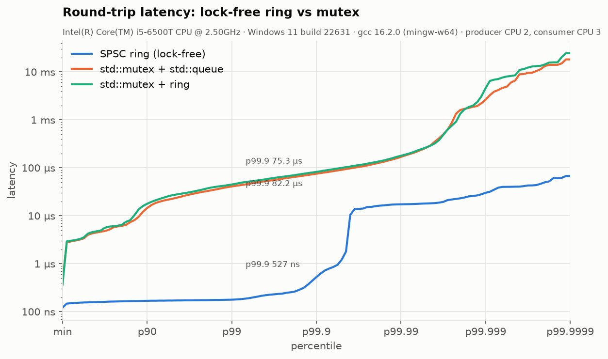
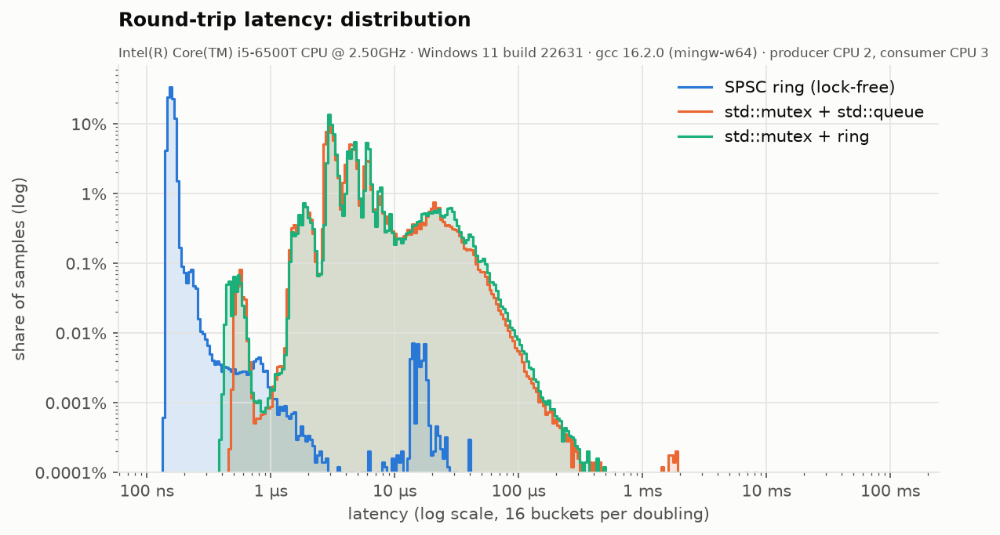
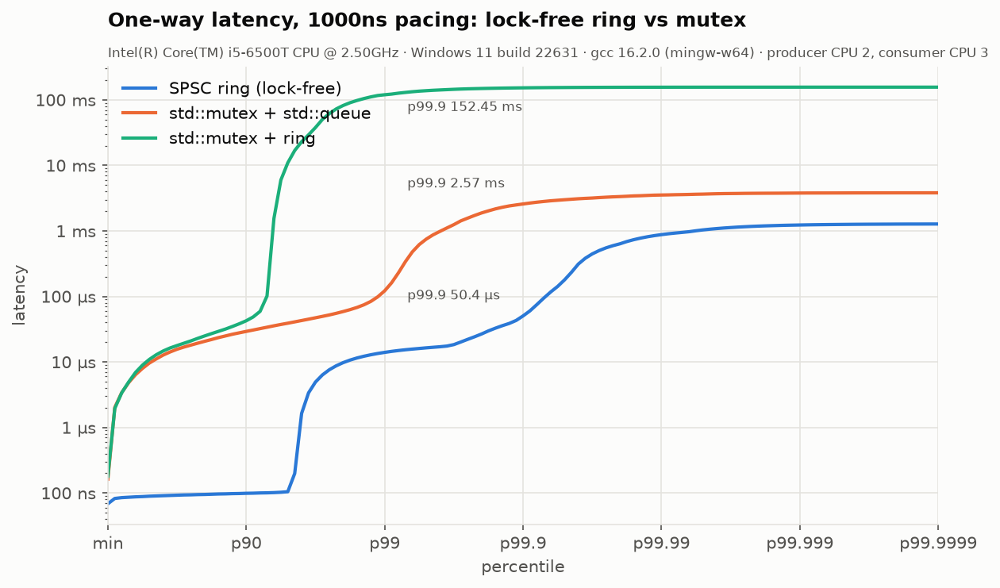
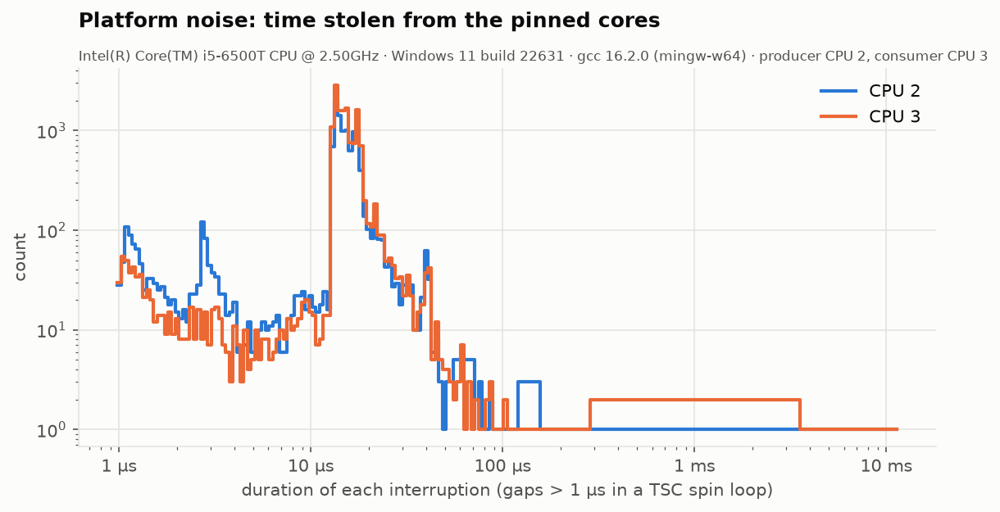
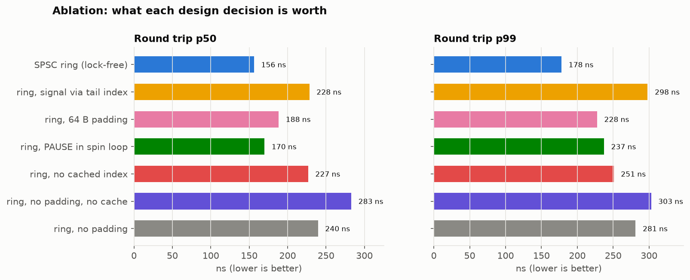
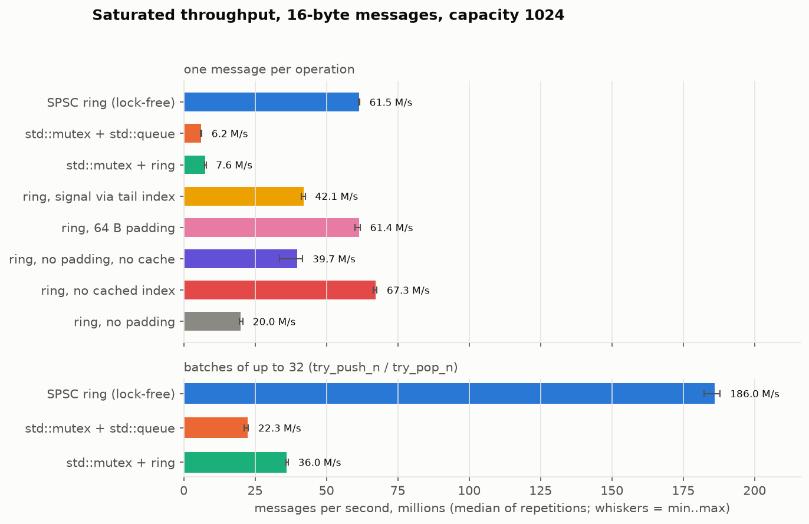

# Results and analysis

All numbers are from `results/i5-6500T_win11/`, produced by
`scripts/run_all.sh i5-6500T_win11` with the C++26 build (v2). The raw files
(every percentile, histogram, and per-repetition Google Benchmark record) are
committed next to the plots. Where a claim depends on a small difference,
repetition ranges are given rather than single medians, and the claim is
cross-checked against the earlier v1 runs on the same machine.

## 1. Machine and method

| | |
|---|---|
| CPU | Intel Core i5-6500T (Skylake, 4 cores / 4 threads, 2.5 GHz base, 6 MiB L3) |
| Memory | 16 GB |
| OS | Windows 11 Pro 23H2, build 22631, **VBS on** (Windows runs as the Hyper-V root partition), Balanced power plan |
| Compiler | GCC 16.2.0 (MSYS2 UCRT64), `-std=c++26 -O3 -march=native -freflection -fcontract-evaluation-semantic=ignore`, static |
| TSC | invariant, calibrated at 2.4960 GHz |
| **Producer thread** | **pinned to CPU 2** (`SetThreadAffinityMask`) |
| **Consumer / echo thread** | **pinned to CPU 3** |
| Profiler sampler (flame graphs only) | pinned to CPU 1 |
| Priority | process `HIGH_PRIORITY_CLASS`, threads `THREAD_PRIORITY_TIME_CRITICAL` |
| Left alone | CPU 0, which takes most device interrupts and DPCs |
| Messages | 16 bytes (`seq`, `tsc`), queue capacity 1024 |
| Samples | 1 M per repetition × 5 repetitions = **5 M per latency figure**, after 100 k warm-up each |

Pinning and priority are applied in code (`harness/platform.cpp`) and recorded
in `machine.json`, which C++26 reflection generates from the `MachineInfo`
struct. The Google Benchmark context of every run also carries each variant's
exact compile-time layout, again generated by reflection, e.g.
`variant ring => padding=128 cache_remote_index=true signal=slot_sequence`.
The full method is in [HARNESS_SPEC.md](HARNESS_SPEC.md).

**What this machine is not:** an isolated, tuned latency box. It is a desktop
with a browser and an IDE running, under a hypervisor. Section 4 measures how
much that costs.

## 2. Headline: p50 / p99 / p99.9

### Round trip (producer → echo thread → producer), 5 M samples

| queue | p50 | p99 | **p99.9** | p99.99 | max |
|---|---:|---:|---:|---:|---:|
| **SPSC ring (lock-free)** | **156 ns** | **178 ns** | **527 ns** | 17.3 µs | 1.60 ms |
| `std::mutex` + `std::queue` | 4.01 µs | 40.9 µs | 75.3 µs | 169 µs | 123 ms |
| `std::mutex` + preallocated ring | 4.25 µs | 44.8 µs | 82.2 µs | 178 µs | 96 ms |

The ring is **26× faster at p50, 230× at p99 and 143× at p99.9**. A round trip
is two hand-offs, so one cross-core hand-off costs about **78 ns**.

### One-way, paced at 1 message / µs (coordinated-omission safe), 5 M samples

| queue | p50 | p99 | **p99.9** | p99.99 | median of per-rep p99 |
|---|---:|---:|---:|---:|---:|
| **SPSC ring (lock-free)** | **89 ns** | **14.0 µs** | **50.4 µs** | 877 µs | 13.9 µs |
| `std::mutex` + `std::queue` | 9.66 µs | 122 µs | 2.57 ms | 3.53 ms | 80.9 µs |
| `std::mutex` + preallocated ring | 11.0 µs | *119.5 ms* ² | *152 ms* ² | 156 ms | 59.4 µs |

² One of the five `mutex_ring` repetitions hit a single **156 ms** stall. With
coordinated-omission-safe timing, that one stall delays ~150 000 messages, 3 %
of the pooled samples, and it dominates the pooled tail. The other four
repetitions had p99 between 54 µs and 834 µs. The per-repetition column shows
the typical behaviour. The ring's five repetitions are tightly grouped
(p99 12.7-14.5 µs).

### Saturated throughput (median of 5, range in brackets)

| queue | one message per op | batches of 32 (`try_push_n` / `try_pop_n`) |
|---|---:|---:|
| **SPSC ring (lock-free)** | **61.5 M/s** (61.2 – 61.6) | **186.0 M/s** (182.4 – 187.9) |
| `std::mutex` + `std::queue` | 6.2 M/s (5.9 – 6.3) | 22.3 M/s (21.1 – 22.6) |
| `std::mutex` + preallocated ring | 7.6 M/s (7.4 – 7.8) | 36.0 M/s (35.7 – 36.7) |

## 3. Why they differ: the flame graphs

Both flame graphs profile the saturated-throughput workload for 5 s at
2 kHz per thread (~20 000 stacks each), using the in-process sampler in
`harness/sampler.cpp`. Open the SVGs in a browser to zoom and search.

* [`throughput_ring.svg`](../results/i5-6500T_win11/flamegraphs/throughput_ring.svg)
* [`throughput_mutex_queue.svg`](../results/i5-6500T_win11/flamegraphs/throughput_mutex_queue.svg)

Where the samples land (leaf frame, share of all samples):

| `std::mutex` + `std::queue` | % | lock-free ring | % |
|---|---:|---|---:|
| `ntdll!ZwWaitForSingleObject` (both threads) | **40 %** | consumer polling the slot's sequence number (`ready`) | 40 % |
| `pthread_mutex_lock` / `unlock` (user-mode part) | 42 % | producer checking for space (`free_slots`) | 40 % |
| `ntdll!ZwSetEvent` | **13 %** | consumer reading the slot and releasing it | 9 % |
| allocator (`operator new`, `deque` growth) | 0.7 % | producer writing the slot and publishing it | 7 % |
| everything else | ~4 % | other | 4 % |
| | | **system calls** | **0 %** |

**The mutex queue spends over half of its time in the kernel.** GCC's
`std::mutex` on MinGW is a winpthreads `pthread_mutex_t`. When it is
contended, it puts the loser to sleep on a kernel event (`ZwWaitForSingleObject`)
and the unlocker must make a system call to wake it (`ZwSetEvent`). A system
call plus a wake-up costs microseconds, and with a producer and a consumer
hammering the same lock it happens on most operations. The tail is the
scheduler: a thread that went to sleep has to be scheduled back, and how long
that takes is up to the OS (the 156 ms stall above is that, at its worst).

**The ring never enters the kernel.** All of its time is user-mode loads and
stores, and almost all of that is the two threads waiting on each other's
cache lines: the consumer polling for the next slot, the producer polling for
free space. That is the cost of *cache coherence*, about 40-60 ns per line
transfer between two cores on this part. Since v2, a hand-off is **one** line
transfer (the slot carries its own "ready" flag, §5), hence ~78 ns.

**Allocation is not the problem.** The allocator is 0.7 % of the mutex
profile, and replacing `std::deque` with a preallocated ring under the same
mutex leaves round-trip latency unchanged (4.25 vs 4.01 µs).

**Why the mutex queues collapse when paced (§2, one-way).** At 1 message/µs the
offered load is far below their saturated throughput (6-8 M/s), yet the median
is ~10 µs and the mean 23 µs. By Little's law (L = λW), a 23 µs mean at
1 message/µs means about 23 messages are waiting on average: the queue is
backed up. The cause is the same kernel hand-off. Each time the producer loses
the lock it sleeps for microseconds. Because timestamps are the *scheduled*
send time, every message that should have gone out while it slept is charged
the delay. A benchmark that timestamps at the actual send would hide this.

## 4. The machine's noise floor: why the ring has a one-way p99 of 14 µs

The harness runs a "hiccup meter" first: a pinned thread spins on the TSC for
5 s and records every gap over 1 µs, i.e. every time the core was taken away.

| CPU | interruptions / s | typical length (p50) | p99 | worst | CPU time stolen |
|---|---:|---:|---:|---:|---:|
| 2 (producer) | 2 343 | 14.8 µs | 40 µs | 11.6 ms | **4.0 %** |
| 3 (consumer) | 2 947 | 15.0 µs | 40 µs | 11.5 ms | **5.4 %** |

Earlier runs on the same machine measured anywhere from 820 to 3 100
interruptions/s. The noise moves with whatever else the desktop is doing,
which is why it is measured **in the same run** as the queues.

The pinned cores lose ~2 300-2 900 slices of ~15 µs every second. Applied to
the one-way benchmark, which sends one message per µs:

* a 15 µs stall delays the ~15 messages scheduled during it, so about
  2 900 × 15 / 1 000 000 ≈ **4-5 % of all messages** fall inside an OS stall;
* hence the ring's one-way p50 is a clean 89 ns, but its **p99 (14.0 µs) is
  the length of a typical interruption**, and its p99.9 is the length of a
  long one.

In other words, past roughly p95, the ring's one-way distribution measures
**Windows, not the ring**. The round-trip benchmark is less exposed, because
the producer does not send while it waits, so a stall costs one sample instead
of fifteen. That is why its p99.9 is 0.5 µs and not 50 µs.

The ~15 µs interruption length and the fact that VBS is enabled point at
hypervisor-mediated timer and interrupt handling. I have not proven that and
would confirm it with an ETW trace. To get production-grade tails you change
the machine, not the queue: Linux with `isolcpus`, `nohz_full` and
`rcu_nocbs` on the hot cores, IRQs steered away, a fixed CPU frequency, and no
hypervisor.

## 5. What made v2 faster, and what each design decision is worth

### v1 → v2 on the same machine

| | v1 (C++20, signal via `tail`) | v2 (C++26, signal in the slot) | change |
|---|---:|---:|---:|
| Round trip p50 | 238 ns | **156 ns** | **-34 %** |
| Round trip p99 | 299 ns | **178 ns** | **-40 %** |
| Round trip p99.9 | 986 ns | **527 ns** | **-47 %** |
| One-way p50 | 130 ns | **89 ns** | -32 % |
| Throughput, per message | 41.2 M/s | **61.5 M/s** | **+49 %** |
| Throughput, batched ×32 | (no API) | **186.0 M/s** | **4.5× v1** |

The v1 design is still measured in every run as `ring_index`, and it
reproduces the v1 numbers (228 ns p50, 42.1 M/s vs 238 ns, 41.2 M/s). So the
improvement comes from the design change, not from a quieter machine.

**Change 1: the "ready" signal moved into the slot.** In v1 the consumer
learned about a new message by reading the producer's `tail`, which lives in
the producer's cache line, and only then read the slot, in a second line.
That is two *dependent* cross-core misses per message. In v2 every slot
carries `seq = index + 1`, written with release right after the payload, and
slots are padded to 32 bytes so the payload and its sequence number always
share one line. The consumer polls the slot itself and never reads `tail`:
**one line transfer per hand-off instead of two.** This is the idea behind the
LMAX Disruptor's per-slot sequence and FastForward-style queues.

**Change 2: batch API.** `try_push_n` / `try_pop_n` move up to N messages per
synchronisation. Throughput triples (61.5 → 186 M/s). The mutex queues get
the same API (one lock per batch) and also improve 3.6-4.7×, but stay
5-8× behind. Batching is a throughput tool: a message that waits to fill a
batch pays for it in latency, so the per-message API remains the default for
latency-critical paths.

### Ablation

Each variant changes exactly one compile-time knob of `spsc::Tuning`, so the
comparison is like for like.

| variant | RTT p50 | RTT p99 | throughput M/s |
|---|---:|---:|---:|
| **default: slot sequence + 128 B padding + cached index** | **156** (153-159) | **178** (174-203) | 61.5 (61.2-61.6) |
| signal via `tail` index (= v1) | 228 (226-261) | 298 (263-307) | 42.1 (41.1-42.6) |
| 64 B padding | 188 (164-199) | 228 (199-233) | 61.4 (60.1-61.9) |
| `PAUSE` in the spin loops | 170 (166-173) | 237 (236-240) | – |
| no cached remote index | 227 (223-232) | 251 (240-271) | **67.3** (66.3-67.7) |
| no padding | 240 (237-241) | 281 (278-284) | 20.0 (19.4-20.7) |
| textbook Lamport (no padding, no cache, index signal) | 283 (264-288) | 303 (296-305) | 39.7 (33.5-41.7) |

Latencies in ns; brackets are the min-max over 5 repetitions.

* **Slot-sequence signalling is the largest single win**: -32 % p50, -40 % p99,
  +46 % throughput against the same queue signalling via `tail`.
* **128 B beats 64 B padding on latency** (156 vs 188 ns p50, ranges do not
  overlap), with equal throughput. v1 switched its default from 64 to 128 after
  measuring the same direction on p50; v2 confirms it with a wider margin.
* **No padding is now the worst throughput (20 M/s).** With everything packed
  in one line, the producer's `tail` store and the consumer's `head` store hit
  the same line on every message, and so do the read-only `capacity_` /
  `slots_` fields both threads need on every operation. Every operation misses.
* **An open question: "no cached index" has *higher* throughput (67.3 vs
  61.5 M/s) but worse latency.** The ranges don't overlap, so it is real. I
  don't have a verified explanation yet. My hypothesis: reading `head` on every
  push keeps the producer from racing ahead to a completely full queue, where
  it ends up writing into the same 64-byte line the consumer is reading (two
  32-byte slots per line). The test is to count cross-core line transfers per
  message (`perf c2c` on Linux, or the `MEM_LOAD_L3_HIT_RETIRED.XSNP_HITM`
  counter). Until then the default stays tuned for latency, which is what the
  queue is for.

## 6. An optimisation that did not help: `PAUSE` in the spin loop

**The idea.** Every guide to spin-waiting says to put `_mm_pause()` in the loop.
`PAUSE` tells the core it is in a spin-wait. That avoids the memory-order
machine clear when the awaited store finally arrives, and it saves power and
frees the sibling hyper-thread. The expectation was a faster exit from the
wait loop and therefore lower latency.

**The measurement** (`ring_pause`, the same queue with `PAUSE` on both sides),
across three full runs:

| | busy spin p50 | `PAUSE` p50 | busy spin p99 | `PAUSE` p99 |
|---|---:|---:|---:|---:|
| v2 (this run) | 156 ns | 170 ns (+9 %) | 178 ns | 237 ns (**+33 %**) |
| v1, run 2 | 238 ns | 231 ns | 299 ns | 437 ns (+46 %) |
| v1, run 1 | 250 ns | 248 ns | 354 ns | 451 ns (+27 %) |

**p99 is worse in all 15 repetitions across the three runs.** p50 is at best
unchanged, and in v2, where the hand-off itself is faster, it is now
measurably worse too: every `PAUSE` repetition is slower than every busy-spin
repetition.

**Why.** From Skylake onwards Intel raised the latency of `PAUSE` from about
10 cycles to about 140 cycles (~56 ns at 2.5 GHz), to cut power use in
spin-waits. When the message arrives while the consumer is inside a `PAUSE`,
it waits for the instruction to finish, and in a round trip that can happen
on both sides. The faster the hand-off becomes, the larger that fixed 56 ns
is in proportion, which is why v2 shows it at p50 and v1 mostly did not. The
benefits `PAUSE` is meant to give don't apply here: this i5 has no
hyper-threads to yield to, and power doesn't matter on a dedicated core.

**Conclusion:** on dedicated cores, busy-poll. Use `PAUSE`, or better a
spin-then-park policy, only when cores are shared or hyper-threaded. This
choice depends on the microarchitecture, which is why it is a policy parameter
of the benchmark and not baked into the queue.

**Also did not help:** removing the allocation from the mutex queue
(`mutex_ring`). Round-trip latency was unchanged (4.25 vs 4.01 µs in v2;
4.12 vs 4.32 and 4.16 vs 4.09 µs in the v1 runs). The flame graph says why:
0.7 % of the time is in the allocator and over 50 % in the kernel.

## 7. Threats to validity

* **Single machine, desktop OS, hypervisor present.** Absolute tails are
  specific to this box (§4). The *ratios* between queues at p50 and p99, the
  flame-graph mechanism, and the ablation ordering are the transferable results.
* **Timing overhead.** `lfence; rdtsc; lfence` … `rdtscp; lfence` adds roughly
  30-40 cycles (~15 ns) to every round-trip sample. It is the same for every
  queue, so it shifts absolute values and not comparisons.
* **One-way latency assumes synchronised TSCs.** This CPU reports an invariant
  TSC. Single-socket Intel parts are synchronised at reset, and the minimum
  one-way latency of 69 ns (never negative, about half the 122 ns minimum
  round trip) is a sanity check that passed.
* **Turbo.** The i5-6500T turbos to 3.1 GHz, and the power plan was left at
  Balanced, so frequency was not fixed. Five repetitions with ranges reported is
  the mitigation; a fixed-frequency rerun would be stronger.
* **The mutex baseline is GCC/winpthreads.** MSVC's `std::mutex` (SRWLOCK) spins
  longer before sleeping and would likely do better than the 4 µs p50 here.
  Every lock that eventually sleeps has the same failure mode under contention.
* **Contracts are compiled out of the measured binaries**
  (`-fcontract-evaluation-semantic=ignore`). With checking on, `pop()`'s
  precondition would add a cross-core load per message; the tests run with
  `enforce`.
